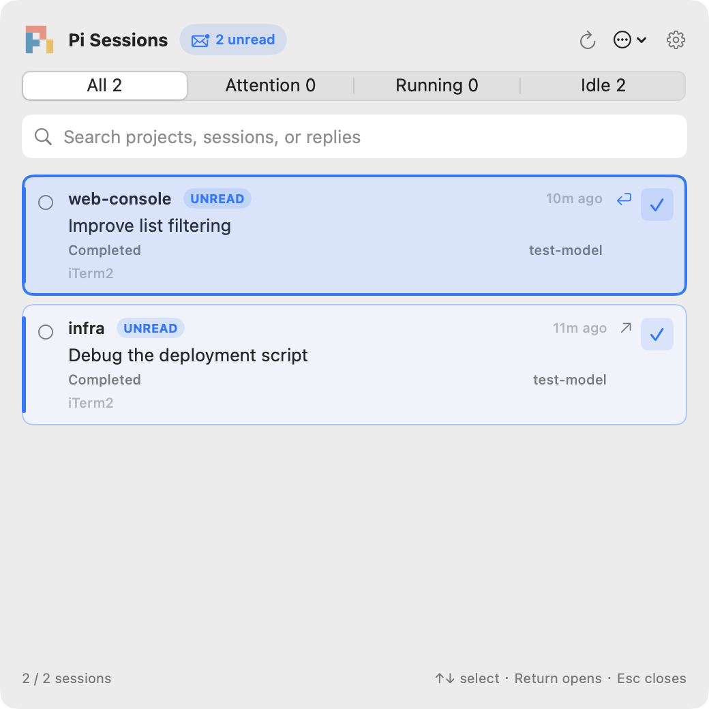

# Pi Sessions

A native SwiftUI + AppKit menu-bar panel for local Pi sessions. No Dock icon,
WebView, HTTP server, or extra Node daemon. Includes unread filtering, keyboard
navigation, notifications, and precise iTerm2 focus. Inspired by
[pi-beacon](https://git.sr.ht/~tonyseek/pi-beacon).



## Install / update

Requires macOS 13+, Xcode Command Line Tools, Node.js 22.19+, [Pi](https://pi.dev),
and iTerm2. Tested with `@earendil-works/pi-coding-agent` 1.3.0. Ordinary tmux works;
`tmux -CC` is not supported. There are no third-party Swift packages.

```sh
git clone https://github.com/yw-meituan/pi-sessions.git
cd pi-sessions
bash install.sh
```

Installs `~/Applications/Pi Sessions.app` and links the extension into
`~/.pi/agent/extensions/session-panel`. `PI_CODING_AGENT_DIR` overrides the extension
destination; `PI_SESSIONS_APP_DIR` overrides the app directory. Unmanaged files are
never replaced. Shell profiles are not changed.

Keep this checkout in place: the installed extension is a symlink to it. To update,
run `git pull --ff-only` and `bash install.sh` from this directory. The installer
builds, tests, and restarts the app. Existing Pi sessions need `/reload` when
enabling/updating the extension; restart Pi if previously loaded modules remain cached.

For launch at login, add **Pi Sessions** in System Settings → General → Login Items.
The installer does not enable login launch automatically.

The build handles duplicate `SwiftBridging` module maps left by some CLT upgrades
using a build-local VFS overlay. It does not modify system development tools.

## Panel

- Menu bar: choose Official (default), Lucide, Phosphor, Phosphor Bold, or Material in Settings → Appearance. These use [original artwork from Pi and icon libraries](assets/README.md), not generated font variants. Official retains its colors; the others adapt to macOS tint. The panel title uses the same choice. Changes apply immediately and persist. Removed styles fall back to Official.
- Open Settings with the top-right gear or `⌘,`. Counts stay in the panel and tooltip.
- English interface; session names, tasks, and custom prompt text stay in their original language.
- Horizontal tabs: **All / Attention / Running / Idle**, with live counts.
- Click the **unread** badge (or `⌘⇧U`) to show all unread sessions; click again or choose a status tab to leave the filter.
- Attention stays first, then unread completions, then other sessions; pins lead within each group.
- Unread rows have an **UNREAD** label, accent border, and leading stripe. Click **✓** at the top right to mark read without opening the terminal; opening a session successfully or choosing **Mark Read** also clears it.
- Search by project/path, session name, task, activity, model, or session ID.
- Scrollable rows show project, `/name` or latest prompt excerpt, activity, model,
  and time since the last activity change.
- The chosen tab is remembered; state changes never force-switch tabs.
- With search focused, use **↑ / ↓** to select a live session and **Return** to open it; the highlight scrolls into view. Search/filter changes select the first match; background updates preserve the selected session. Arrow keys leave input-method composition and modified text-editing shortcuts alone.
- Click a row to jump; click outside or press Escape to close.
- Opening with the global shortcut moves the pointer to the panel center. Closing or opening by mouse leaves it in place.
- `…` opens the state directory or quits the app.

If macOS hides the menu icon behind the notch, open the app through Spotlight or:

```sh
open "$HOME/Applications/Pi Sessions.app"
```

Reopening shows the panel even when its status item is offscreen. Hold Command
and drag the menu icon to reposition it when visible.

## Notifications

Enable completion and attention notifications separately in **Settings → Notifications**.
Sessions that keep waiting for input or confirmation repeat their notification every
**10 minutes** by default. Toggle **Repeat while attention is needed** or set
**Remind every** to 1–1440 minutes. Changes are saved immediately.

Reminders stop when the prompt clears or the session exits. Opening or dismissing
a notification does not resolve the prompt. Reminders respect **Silence the session
I'm viewing**, sound, and preview settings, and replace the previous notification
instead of accumulating. macOS notification permission and Focus settings still apply.

Pi Sessions must remain running. Checks run every 15 seconds; restart, re-enabling
reminders, or changing the interval starts a fresh countdown. Waking from sleep
does not replay missed intervals.

## State and focus

The extension publishes lifecycle events, not transcript polling. Completion uses
`agent_settled`, so retries and automatic continuations remain busy. Tool calls,
UI prompts, compaction, aborts and errors have separate activity labels.

The app watches atomic file replacements with 200 ms debounce. Every 15 seconds
it updates relative times and checks process identity using `proc_pidinfo`, not
spawned `ps` commands. PID plus process start time prevents ghost sessions from
PID reuse. Corrupt and stale files are ignored. Normal shutdown removes the row.
Reload/new/resume/fork replaces the runtime ID, invalidating old clicks.

On click, the app rechecks identity, resolves the pane's current tmux
session/window/client and matches client TTYs to live iTerm2 sessions. It then
selects the pane and iTerm2 split/tab/window, preserving tmux zoom. In a zoomed
window, selecting another pane shows that pane zoomed; unzoomed windows stay unzoomed.
No inherited `ITERM_SESSION_ID` is trusted. No shell startup or Node process is
needed for a click; tmux and AppleScript commands run on a background queue.
Pane/client lookup uses one tmux call; iTerm2 TTYs are read in batches.
Background visibility checks deduplicate by socket and run on a separate queue,
so clicks do not wait behind them.

Prefer a client already attached to the target, otherwise the most recently
active iTerm2 client. A detached session uses that existing client; if there is no
local client, report an error instead of creating a window or typing commands.
Without tmux, focus the matching terminal TTY. Nested tmux, remote SSH, and tmux
control mode are not supported/tested. macOS controls cross-Space animations.

First click may request **Automation → Pi Sessions → iTerm2** permission. Errors
appear in the panel. No Accessibility permission is required. This is a locally
ad-hoc-signed app, not a notarized distribution.

## Local data

`~/Library/Application Support/PiSessionPanel/sessions/<pid>.json`

Directory mode `0700`; files `0600`. Contains process/session identity, cwd,
name, latest prompt excerpt (100 characters), model, activity, terminal location,
last assistant reply summary, and local links. No full transcript, tool arguments,
or results. Recent exited snapshots are kept for 7 days, up to 100 sessions.
Notification previews may show reply text; disable previews in Settings if needed.
The app and extension make no network requests; clicked local links open in your browser.
Only local interactive macOS sessions publish; RPC/print/JSON children do not.

## Diagnose / test

```sh
APP="$HOME/Applications/Pi Sessions.app/Contents/MacOS/PiSessions"
"$APP" --diagnose
"$APP" --self-test
"$APP" --render-demo /tmp/pi-sessions.png
node --test test/core.test.mjs
```

`--render-demo` briefly opens a separate demo panel with 24 synthetic sessions,
saves a PNG, and exits. It never writes fake sessions to the state directory.

Lifecycle integration (set `PI_PACKAGE_DIR` to the installed coding-agent package):

```sh
TEST_HOME=$(mktemp -d)
HOME="$TEST_HOME" PI_PACKAGE_DIR="/path/to/@earendil-works/pi-coding-agent" \
  node test/lifecycle.mjs
rm -r "$TEST_HOME"
```

## Remove

Quit Pi Sessions, remove `~/Applications/Pi Sessions.app` and the
`~/.pi/agent/extensions/session-panel` symlink, then reload Pi. If enabled, remove
its login item in System Settings. Runtime data can then be removed from
`~/Library/Application Support/PiSessionPanel`. Preferences are stored under
`local.pi.sessions`. Honor your custom installation paths if you used overrides.
